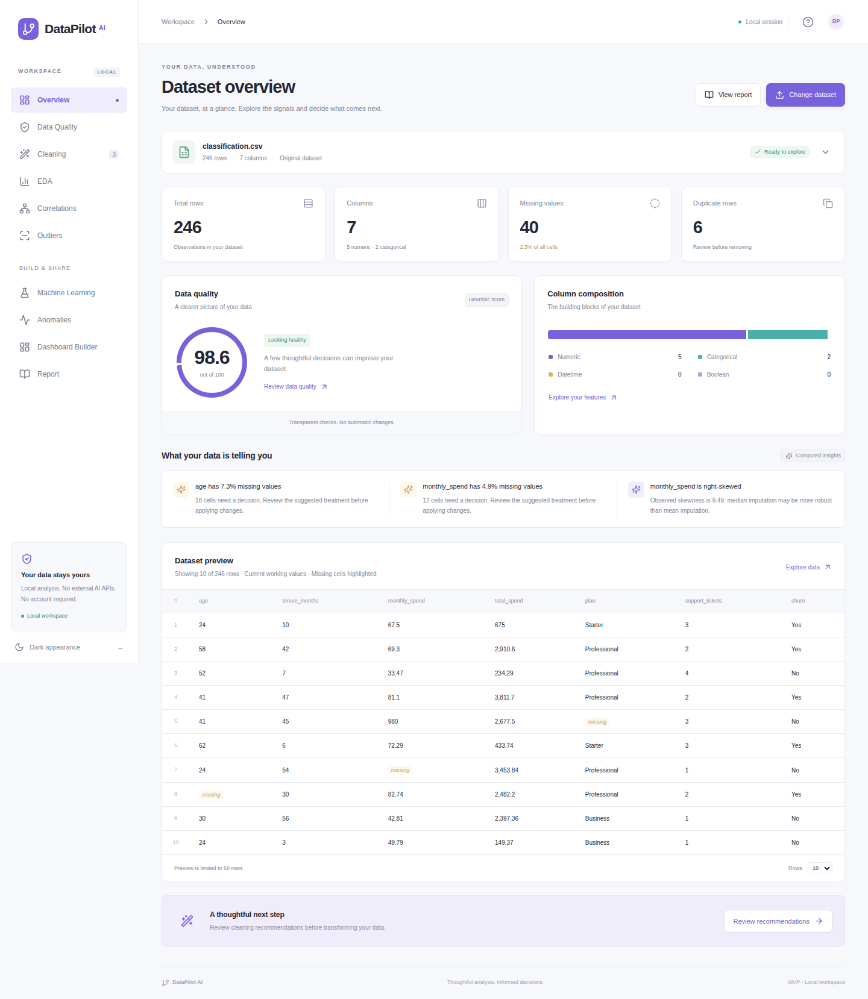
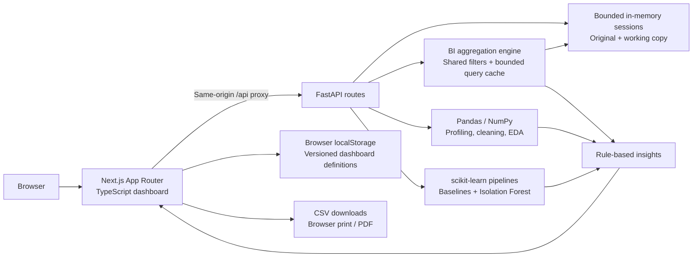
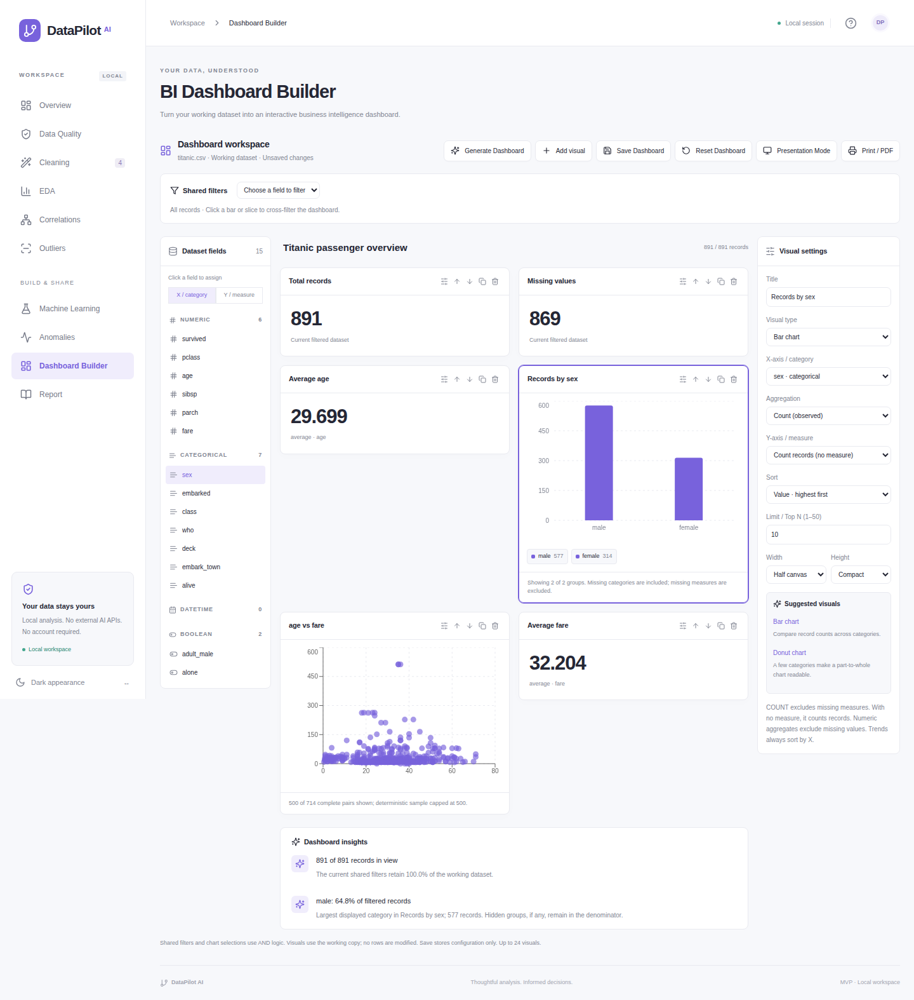

# DataPilot AI

**Your data, understood.** An automated data science and business intelligence platform for transforming raw datasets into cleaned data, exploratory analysis, machine-learning diagnostics, interactive dashboards, and actionable insights. All insights come from computed results; “AI” refers to local machine learning and rule-based recommendations. No LLM API, account, database, or paid service is required.

## Features

- CSV / XLSX upload, schema inference, dataset preview, descriptive statistics, and explicit resource limits.
- Transparent 0–100 quality heuristic with individually explained penalties.
- Missing-value recommendations with editable strategies and reasons, including mean, median, mode, constants, drops, ordered fills, and interpolation.
- Atomic cleaning, duplicate and column removal, strict type conversion, original-data reset, before/after comparisons, and CSV downloads.
- Numeric histograms and box plots, categorical frequencies, sampled scatter plots, Pearson/Spearman heatmaps, and configurable correlation thresholds.
- IQR and conditional Z-score outlier review. No automatic deletion.
- Two supervised baselines per task with training-only preprocessing, held-out evaluation, training-set cross-validation, learning curves, and feature importance.
- Optional Isolation Forest analysis, scores, flagged row previews, and exports.
- Rule-based insights, a printable report, responsive navigation, and light/dark appearance.
- **BI Dashboard Builder:** a three-panel workspace with KPI cards, interactive charts, shared slicers, cross-filtering, a paginated table, automatic dashboard generation, browser configuration persistence, and presentation / print export.

## Screenshots

<!-- Replace or supplement these with captures of your own dataset. Never publish private data. -->

The browser smoke test writes actual application captures to `docs/screenshots/`:

- `overview.png` — sample dataset overview.
- `mobile.png` — responsive overview.
- `machine-learning.png` — trained classification baselines.



[Mobile layout](docs/screenshots/mobile.png) · [Model evaluation and learning curves](docs/screenshots/machine-learning.png)

## Architecture



```text
backend/app/
  main.py                 FastAPI setup and error handling
  api/routes.py           Existing analysis endpoint orchestration
  api/dashboard.py        BI schema, field values, and query endpoints
  schemas/requests.py     Validated cleaning / ML / anomaly requests
  services/
    upload.py             Bounded CSV and workbook parsing
    storage.py            Immutable original + mutable working copy
    profiling.py          Types, statistics, recommendations, quality
    cleaning.py           Atomic, explicitly requested changes
    eda.py                Chart-ready aggregates and scatter samples
    correlation.py        Pearson / Spearman and pair diagnostics
    outliers.py           IQR and conditional Z-score checks
    ml.py                 Train/test pipelines and diagnostics
    anomalies.py          Isolation Forest
    insights.py           Observations grounded in computed results
    dashboard.py          Read-only BI filtering and aggregations
  utils/                  Strict JSON serialization and request limits
backend/tests/            Statistical and API regression tests
frontend/
  app/                    App Router dashboard, layout, responsive theme
  components/             Shared UI, tables, charts
    dashboard/            Builder, canvas, fields, settings, filters, widgets
  lib/                    API client and formatting
  types/                  Typed API response and dashboard contracts
  lib/dashboard/          Recommendations, starter generation, configuration
  tests/                  Browser workflow test
examples/                 Reproducible synthetic CSV datasets
scripts/                  Dataset generation and local startup
```

## Tech stack

Next.js 16, React 19, TypeScript, Tailwind CSS 4, Lucide, Recharts; Python 3.12, FastAPI, Pandas, NumPy, SciPy, scikit-learn, and openpyxl. Frontend dependencies are locked in `frontend/package-lock.json`; tested Python versions are recorded in `requirements.lock.txt`.

## Data science pipeline

1. **Upload and profile.** Preserve parsed original values; infer semantic column types separately. Pandas' default CSV missing markers (including blank, `NA`, and `NULL`) count as missing. Infinities count as missing for analysis without silently rewriting the original.
2. **Review quality.** Inspect missingness, repeated rows, constants, detectable case/whitespace variants, and statistical extremes. These checks cannot establish real-world correctness.
3. **Choose cleaning.** Recommendations are heuristics. An approximately symmetric numeric column suggests mean; skewed data or IQR extremes suggest median. Dominant categories may suggest mode; otherwise an explicit unknown category is offered. At ≥60% missingness, removal is suggested for review. Below 2%, dropping rows is mentioned as an alternative. Date gaps default to unchanged.
4. **Apply explicitly.** The API converts types, orders rows if requested, applies selected missing treatments, drops selected columns, then optionally removes duplicates. Failed conversions or an empty result leave the working copy unchanged. Mode ties use Pandas' first mode. Forward/backward fills require a complete, unique ordering column. Interpolation uses equally spaced **row positions**, not elapsed time, and preserves boundary gaps. Zero requires a separate domain confirmation.
5. **Explore.** Descriptive statistics use available finite observations. Scatter plots sample at most 500 rows with a fixed seed. Category charts show the 12 largest categories plus the rest combined. Correlations use pairwise complete rows, with at least three pairs. Constant-column correlations are undefined. Correlation does not imply causation.
6. **Train only when confirmed.** Supervised ML uses the **original upload**, avoiding contamination from exploratory full-dataset imputation. Missing-target rows and exact duplicates are excluded from the modeling view only. Users can exclude identifiers and post-outcome features. The target/task suggestion is overridable. Preprocessing (imputation, encoding, optional scaling) is fitted inside the training pipeline and every cross-validation fold. Classification uses a stratified holdout; regression uses a random holdout. Seed 42 makes the splits reproducible.
7. **Evaluate cautiously.** Classification reports accuracy, weighted precision/recall/F1, confusion counts, and binary ROC-AUC when applicable. Regression reports MAE, RMSE, and R². Up to three folds use only the training partition. Learning curves require ≥100 training rows and ≥5 observations per class. Invalid curve folds can be omitted and undefined values serialize to null. A train–CV gap >0.15 suggests possible overfitting; both scores <0.60 suggest possible underfitting. These thresholds are illustrative, not a formal bias–variance decomposition.
8. **Review anomalies and report.** Isolation Forest uses varying numeric features with median imputation and scaling. Contamination is user-controlled; no flags are deleted. Reports distinguish current working data from models trained on the original.

### Quality score formula

This is a project-specific communication tool, **not an industry standard**:

```text
score = max(0, 100 − sum(penalties))

40 × missing-or-nonfinite cells / all cells
20 × duplicate rows / all rows
10 × constant-or-empty columns / all columns
15 × columns with ≥60% missingness / all columns
10 × min(1, (nonfinite cells + text inconsistency count) / all cells)
 5 × potential IQR outlier cells / all cells
```

Text inconsistency count combines whitespace-affected cells and extra case/whitespace variants. Missingness and infinity can intentionally contribute to multiple factors. Possible outliers receive only a small penalty because they may be legitimate. An empty dataframe scores zero. The API exposes every observed penalty.

### Models and preprocessing

| Task | Models | Test metrics |
| --- | --- | --- |
| Classification | Logistic Regression, Random Forest Classifier | Accuracy, weighted precision/recall/F1, confusion matrix, binary ROC-AUC |
| Regression | Linear Regression, Random Forest Regressor | MAE, RMSE, R² |

`ColumnTransformer` combines median-imputed numeric features and constant-imputed categorical features encoded with `OneHotEncoder(handle_unknown="ignore")`. Standard scaling is optional. Empty/constant features and categorical features with >100 unique training values are excluded and reported; one-hot encoding caps each retained feature at 30 output categories. Forests use 80 trees, depth ≤12, and leaves of at least two samples. Feature importance is impurity-based for forests and absolute coefficient magnitude for linear models; neither establishes causality, and unscaled coefficients have different units.

## Installation

Prerequisites: Python 3.11+ (tested with 3.12), Node.js 20.9+ (tested with 24), npm. Run commands from the repository root unless noted.

### Backend setup

```bash
python3 -m venv .venv
source .venv/bin/activate
pip install -r requirements.lock.txt
uvicorn app.main:app --app-dir backend --host 127.0.0.1 --port 8000
```

Use `requirements.txt` instead of the lock file to resolve compatible newer packages. On Linux, install your distribution's `python3-venv` package if venv creation fails.

### Frontend setup

In another terminal:

```bash
cd frontend
npm ci
cp .env.example .env.local
npm run dev
```

Open **http://localhost:3000**. FastAPI's interactive API reference is at **http://127.0.0.1:8000/docs**. The frontend proxies `/api/*` to the backend; no browser CORS setup is needed. Change `API_URL` in `.env.local` if the backend uses another port.

After dependencies are installed, `./scripts/dev.sh` starts both services and stops both on Ctrl-C. Keep one backend worker: session data is process-local.

For a production frontend build:

```bash
cd frontend
npm run build
npm start
```

Webpack is used for a reproducible build in environments where the Turbopack CSS worker cannot bind a local port. No external font or image download is needed.

## Example workflow

1. Choose **Customer churn** on the landing page, or upload `examples/classification.csv`.
2. Inspect the overview, quality penalties, missing-value suggestions, and preview.
3. Open **Cleaning**, review strategies, optionally select duplicate removal, then **Apply selected changes**.
4. Inspect the before/after counts and download the cleaned CSV. Reset is always available.
5. Explore a histogram, box plot, scatter relationship, and Pearson/Spearman heatmap.
6. Open **Machine Learning**, select `churn`, confirm Classification, and train. For `examples/regression.csv`, choose `price` and Regression.
7. Compare test metrics, confusion counts, cross-validation, learning curves, and feature importance.
8. Optionally run **Anomalies**, inspect flags, and export them.
9. Open **Report**, then **Print / Save as PDF**. Use your browser's PDF destination.

Both examples contain intentional missingness, duplicate rows, numeric and categorical features, and planted extreme values. They are synthetic and are not representative performance benchmarks. Regenerate them with `python scripts/generate_examples.py` after activating the environment.

## API overview

All JSON responses use strict JSON (`NaN` / infinity become `null`). Errors include a human-readable `detail`.

| Method | Endpoint | Purpose |
| --- | --- | --- |
| GET | `/api/health` | Service health |
| POST | `/api/upload` | Multipart `file`: CSV/XLSX; returns session and profile |
| POST | `/api/examples/{classification\|regression}` | Load a synthetic example |
| GET | `/api/profile/{id}` | Current/original profiles, actions, insights |
| POST | `/api/clean/{id}` | Apply explicitly selected operations atomically |
| POST | `/api/reset/{id}` | Restore original; clear actions and model/anomaly results |
| DELETE | `/api/datasets/{id}` | Release session data |
| GET | `/api/eda/{id}` | Chart-ready EDA |
| GET | `/api/correlations/{id}?method=spearman&threshold=0.7` | Correlation matrix and feature pairs |
| GET | `/api/outliers/{id}` | Potential numeric extremes |
| GET | `/api/ml/targets/{id}` | Original columns and task suggestions |
| POST | `/api/ml/train/{id}` | Explicit target/task and baseline training |
| POST | `/api/anomalies/{id}` | Optional contamination setting and flags |
| GET | `/api/report/{id}` | Current analysis and completed model/anomaly results |
| GET | `/api/download/cleaned/{id}` | Working copy CSV |
| GET | `/api/download/anomalies/{id}` | All flagged rows CSV |

Example cleaning body:

```json
{
  "missing": {"age": {"strategy": "median"}, "plan": {"strategy": "constant", "value": "Unknown"}},
  "remove_duplicates": true,
  "drop_columns": [],
  "conversions": {},
  "order_by": null,
  "confirm_zero": false
}
```

Example training body:

```json
{"target":"churn","task":"classification","scale":true,"test_size":0.2,"exclude_columns":[]}
```

CSV exports default to `spreadsheet_safe=true`: formula-like strings/headers are prefixed with an apostrophe in the exported file. This does not alter working data. Use `?spreadsheet_safe=false` when exact text preservation is required by a trusted programmatic consumer.

## Verification

```bash
source .venv/bin/activate
python -m pytest -q
cd frontend
npm run lint
npm run typecheck
npm run build
```

The BI tests also verify Titanic row counts and filtered aggregates against Pandas, all slicer types, missing-category groups, date buckets, table search/pagination, empty results, and cache invalidation. Browser tests cover generation, editing, real bar cross-filtering, save/restore, presentation/print, and reuse of cleaned data.

The API tests cover upload validation, XLSX, original preservation, atomic failures, numeric/categorical edge cases, undefined statistics, both supervised tasks, anomaly export, and training-only imputation.

Browser smoke tests require both services running:

```bash
cd frontend
npx playwright install chromium
npm run test:e2e
```

## Business Intelligence

Open **Dashboard Builder** after uploading or cleaning a dataset. BI always uses the current working copy; it does not alter records or affect the separate original-data ML pipeline.

### Build and explore

- **Generate Dashboard** creates schema-appropriate record/missing KPIs, a numeric average, a low-cardinality category distribution, a date trend when available, and a scatter plot for two sufficiently varied numeric fields (otherwise a histogram). Identifier-like numeric names and constant fields are avoided. These are editable starting points, not claims about business meaning. Generation replaces the current canvas and filters; the saved dashboard is unchanged until Save.
- **Add visual** supports KPI, vertical/horizontal bar, line, area, pie, donut, scatter, histogram, and table. Select a card to edit its title, fields, aggregation, sorting, group limit, date grouping, width, and height. Click fields in the left panel to assign X or Y. Suggestions explain compatible chart choices without enforcing them.
- Widget controls **edit, duplicate, remove, move earlier, and move later**. Width can span half or all of the canvas; height can be compact or tall. No custom drag engine or layout dependency is needed. Up to 24 widgets are supported.
- **KPI cards** support total rows, total columns, missing cells, duplicate rows, and column COUNT, DISTINCT COUNT, SUM, AVERAGE, MIN, MAX. All dataset-level KPIs are recomputed for the filtered subset (column count remains the schema width).
- **Shared filters** support categorical multi-select (Ctrl/Cmd to select multiple), searchable values, numeric ranges, inclusive calendar-date ranges, and Boolean true/false/all/missing. Values within one categorical filter use OR; filters across fields use AND. Clear an individual filter or all filters. Empty selections mean all values. Numeric/date ranges exclude missing observations.
- Click a **bar, pie/donut slice, or category chip** to apply a single shared cross-filter. Clicking the selected value again or clearing the selection chip removes it. The selection is ANDed with slicers and affects all widgets, including its source. Date buckets, histogram bins, and scatter points do not initiate cross-filters. Transient chart selections are not saved.
- **Tables** select columns, sort by clicking headers, search literal text across selected columns, and paginate 10–100 records per page. Table search is local to that visual, not a global filter. A table with no columns selected defaults to the first six. Only its currently displayed page is printed.

### Aggregation semantics and performance

The backend aggregates actual records; the browser never derives BI numbers from the 50-row preview. COUNT without a measure counts records; COUNT with a measure counts observed values; DISTINCT COUNT excludes missing values. SUM / AVERAGE / MIN / MAX require numeric measures and exclude missing/infinite values. An empty numeric aggregate is undefined (`null`, rendered as —), not a fabricated zero. Missing grouping keys appear as `(Missing)` with a distinct internal null key.

Grouped visuals display up to 50 groups (default 10) and identify how many groups are hidden. Pie percentages, when read visually, describe only displayed nonnegative aggregate values. Line/area charts require ordered numeric or date axes and sort by X, with day/month/year date buckets available; missing time periods are not interpolated. Scatter plots display a reproducible sample of at most 500 complete pairs. Histograms use 2–40 bins. Category value pickers show the first 100 matches and offer server-side search for additional values.

Query edits are debounced 350 ms, category searches 250 ms; superseded browser requests are aborted. A request filters once and uses vectorized grouped aggregations. Each dataset caches its prepared schema and up to 12 query responses of at most 1 MB each; larger results are served without retention. Cleaning and reset clear this cache and advance a revision. Invalid visual settings produce an error on that widget; invalid shared filters produce a dashboard error. Existing data is never changed by a BI query.

### Save, present, and export

**Save Dashboard** writes a versioned configuration containing visual settings, order, size, title, and slicers to this browser's localStorage. **Reset Dashboard** clears both the current and saved configuration, without changing the data. Unsaved drafts survive navigation within the loaded workspace; save before reloading. Restoration requires re-uploading a dataset with the same filename and original column names/types. This is a schema association, not a content identity check: review saved definitions when replacing a file with different records. Missing fields in restored configurations are cleared for review. Storage denial or corruption is reported without losing the active dataset.

**Presentation Mode** hides navigation, fields, settings, and edit controls. Exit with its button or Escape. **Print / PDF** uses a print-friendly dashboard with the title and active filters; choose Save as PDF in your browser. The existing analysis Report remains available separately. No external PDF or image service is required.

### Titanic verification

`examples/titanic.csv` is the public [Seaborn Titanic example](https://github.com/mwaskom/seaborn-data/blob/master/titanic.csv), downloaded for these checks (891 records, 15 fields). The [source repository](https://github.com/mwaskom/seaborn-data) attributes it to the Kaggle Titanic dataset. It is an external historical example, unlike the two synthetic datasets. Do not use derived fields such as `alive` to predict `survived`; they reveal the target.

1. Upload `examples/titanic.csv`, open Dashboard Builder, and generate a dashboard.
2. Add a KPI with column `fare` and aggregation Average.
3. Filter `sex` to `female`: the total becomes 314 and average fare is approximately 44.4798, computed from the file.
4. Build a bar chart with X=`pclass`, Y=`survived`, Average to compare observed survival fractions.
5. Save, reload, re-upload the same file, and verify settings and slicers restore. Clear filters and click the male bar: 577 records remain.
6. Present or print the result. Clear the filters before interpreting whole-dataset statistics.

<!-- Screenshot slots: regenerate these with the BI Playwright tests after changing the UI. -->

[Presentation mode screenshot](docs/screenshots/bi-presentation.png)

### BI API

| Method | Endpoint | Purpose |
| --- | --- | --- |
| GET | `/api/dashboard/{id}/schema` | Working-copy fields, types, ranges, category choices, revision |
| GET | `/api/dashboard/{id}/values?column=sex&search=fem` | Bounded searchable field values |
| POST | `/api/dashboard/{id}/query` | Shared filters and multiple visual specifications |

```json
{
  "filters": [{"column":"sex","kind":"categorical","values":["female"]}],
  "visuals": [
    {"id":"records","type":"kpi","metric":"rows","title":"Passengers"},
    {"id":"survival","type":"bar","x":"pclass","y":"survived","aggregation":"average","title":"Survival by class"}
  ]
}
```

The public API schema is documented in FastAPI `/docs`. Dashboard configuration is intentionally independent of storage so persistence can be added later. DAX, Power Query, multi-table models, OLAP, cloud collaboration, enterprise permissions, streaming, and Power BI compatibility are outside this MVP.

## Limitations

- This is a **single-user local MVP** with no authentication. Bind to loopback; it is not a hosted multi-tenant service.
- Upload limits: 10 MB file / 11 MB request, 50,000 rows, 100 columns, two million cells. XLSX uses only the first worksheet, with a 60 MB expanded ZIP limit and at most 1,000 ZIP entries; cached formula values are read and formulas are not executed. CSV requires UTF-8 and comma delimiters.
- Sessions are in-memory, capped at eight and approximately 250 MB of original/current frames; any individual pair is capped at 100 MB. TTL is two hours, checked on access/insertion. Restarting the backend clears all data; browser refresh clears the selected workspace. Multipart parsing may spool temporary bytes on disk; uploads are closed after parsing. Model fitting has additional bounded working memory needs.
- ML requires 30 distinct labeled rows and at most 10,000 rows. Classification supports 2–30 classes with sufficient examples. It does not handle grouped/temporal validation, class rebalancing, hyperparameter search, inference serving, or model persistence. Users must identify target leakage and sampling bias.
- Date inference is conservative. Text inconsistencies are flags, not automatic normalization. Unknown tokens outside Pandas' standard NA markers are not assumed missing. Domain-specific validity is not inferred.
- Correlations and feature selection informed by exploratory analysis can influence choices. Independent external validation is still needed before relying on a model.
- Baseline weighted metrics can hide minority-class failure. Confusion counts are provided; results are estimates from one dataset and split.
- Anomaly contamination is an assumption, not an estimate of actual bad data. Outliers are never automatically removed.
- Browser PDF pagination depends on the browser and dataset width. There is no separate PDF rendering service.

## Future improvements

Time-aware/grouped validation, per-class metrics, permutation importance, missingness mechanism diagnostics, robust type/date controls, selection of Excel worksheets, report pagination for wide tables, and session persistence if the project grows beyond local use.

## Methodology references

- [scikit-learn: avoiding data leakage with pipelines](https://scikit-learn.org/stable/common_pitfalls.html)
- [scikit-learn: cross-validation and held-out evaluation](https://scikit-learn.org/stable/modules/cross_validation.html)
- [Next.js App Router documentation](https://nextjs.org/docs/app)


## Loading and navigation polish

Reusable loading components live in `frontend/components/loading`. Action buttons reserve space for processing labels and guard duplicate requests. Content requests use chart, table, KPI, or widget skeletons. Errors restore controls and analysis/dashboard requests offer retries. Downloads display feedback while preparing the file. Requests time out after 60 seconds (180 seconds for model training); this stops the browser waiting but does not guarantee cancellation of backend computation.

The startup splash covers initial hydration with a 500 ms minimum measured from the initial HTML. The persisted theme is applied in the document head before the body renders. Reduced-motion preferences disable the entrance, fade, and loading animations. Internal section navigation does not restart the splash.

The fixed sidebar has independently scrolling navigation and an accessible footer. The mobile drawer locks background scrolling, contains keyboard focus, supports Escape and a visible close button, and closes on section selection.

English language metadata and ordinary DOM text support browser translation of navigation, explanations, generated insights, reports, chart/KPI titles, and error messages. Only individual brand labels opt out. Native Chrome/Edge translation should be checked manually in the installed browser.

Regression coverage is provided in `frontend/tests/polish.spec.ts`. Final source changes have not been executed or validated following the source-only instruction. Run the frontend lint, typecheck, build, and browser tests manually when ready.


## Visual design system

The existing application uses `frontend/app/design-system.css` for shared screen-only surface, typography, spacing, status, control, table, and responsive layout styles. Both themes use neutral surfaces with an indigo accent; chart presentation tokens are shared through `frontend/lib/chart-theme.ts`. Existing print layouts remain separate.

The header exposes the dataset summary and appearance control. A saved appearance choice takes precedence over the system preference; without a saved choice, the application follows system changes. The startup splash receives the same theme before the body renders. Navigation is grouped by workflow and becomes a scrollable drawer at tablet widths (1024 px and below).

Quality scores and model diagnostic labels retain their existing calculations and explanations. Their status colors are presentation only. No API contracts, dataset operations, model training, or BI aggregation logic were changed. This visual update was performed through source edits only; run the existing frontend lint, typecheck, build, and browser workflows manually before release.
